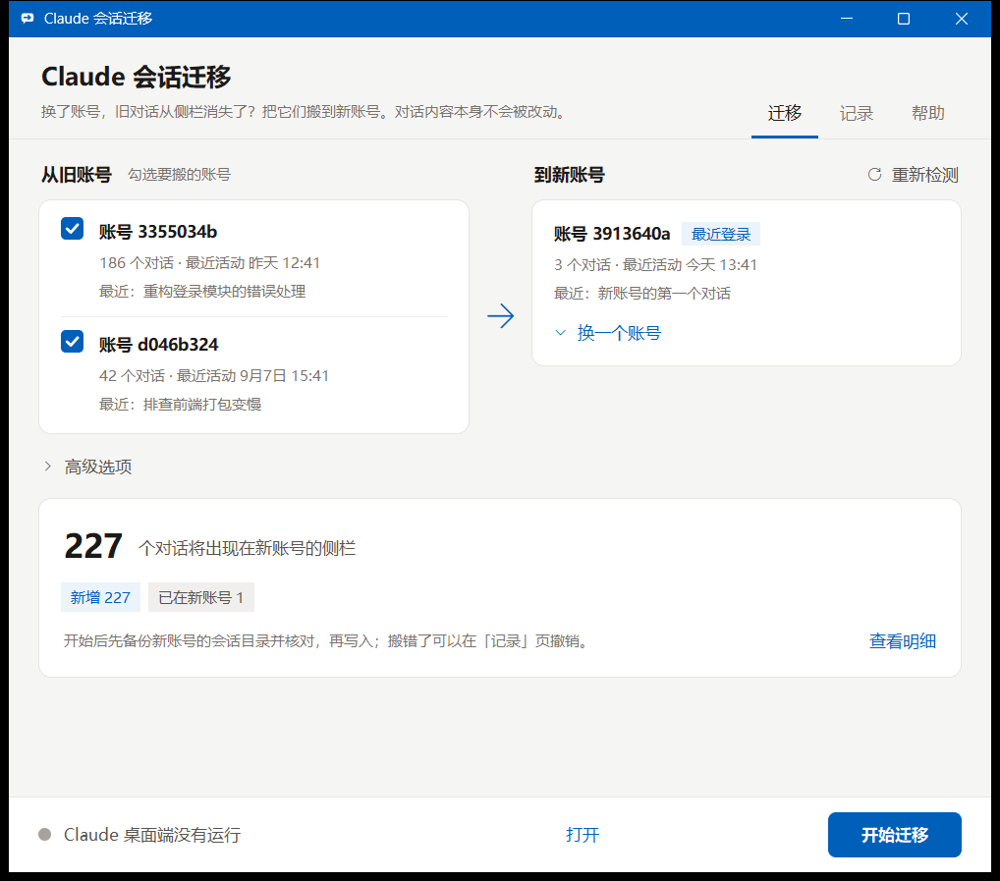
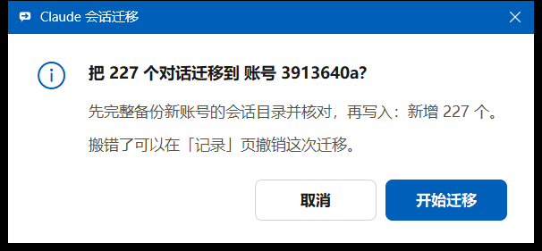
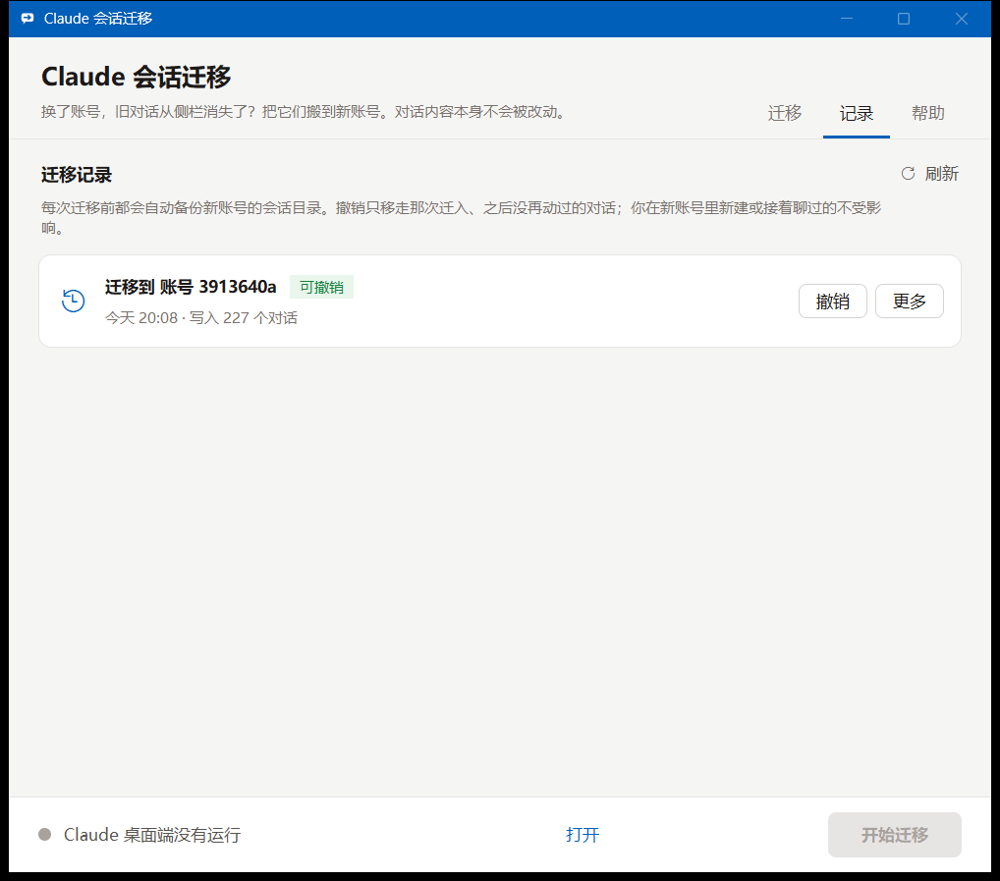

# Claude Session Migrator

[中文](README.md) | **English**

After you switch accounts in Claude Desktop (or switch between claude.ai login and API key mode), all your old conversations vanish from the sidebar. They are still on your computer — the new account's session list is just empty. This small tool copies the old account's session list over to the new account; after Claude Desktop restarts, the old conversations are back in the sidebar and you can pick up where you left off.

The interface is in Chinese; the screenshots below use made-up demo data.



## What it does

- **One page**: tick the old accounts on the left; the new account is on the right (defaults to the one signed in most recently). Each account shows its conversation count and the title of its latest conversation, so you can tell them apart; a live summary below shows how many conversations will move, with a per-conversation detail view.
- **One-click migration**: a single confirmation runs the whole thing — close Claude Desktop → back up and verify → write → reopen Claude Desktop. Only the desktop app itself is closed; Claude Code running in a terminal is left alone.
- **Undo any time**: every migration is backed up first; the "History" page undoes a migration in one click, moving away only what that migration wrote and that hasn't changed since.
- **Safe for your data**: only the sidebar session records (`local_*.json`) are copied; the raw conversations (`.jsonl`) are never read or written. Records already in the new account are never replaced by older ones, and conversations you deleted in the new account are not brought back.
- **Both modes**: accounts under the claude.ai login profile and the API key profile (`Claude-3p`) are scanned together.

| One confirmation, then it runs by itself | Undo per migration |
|---|---|
|  |  |

## Usage

Requires Python 3.8+ (Tkinter is bundled; nothing else to install). Double-click `run.bat`, or run `python gui.py`.

For a standalone exe with an icon (Windows): with PyInstaller installed, run `python build_exe.py --out <new empty folder>` to get a single self-contained file `dist\Claude会话迁移.exe` (copy just that file). Only committed sources are packed.

1. In Claude Desktop, sign in to the **new** account and open the **Code tab** once (that is when the new account's folder is created).
2. Open this tool, check the accounts on both sides, and click **开始迁移** (Start migration).
3. When Claude Desktop reopens, go to the Code tab — the old conversations are in the sidebar.

Picked the wrong account? Click 撤销这次迁移 (Undo this migration), or undo it on the 记录 (History) page. Old conversations not showing? Click 重启 (Restart) at the bottom and make sure you are signed in to the account you migrated into.

## How it works

Claude Desktop stores the sidebar list per account, while the raw conversations are account-independent; the two are linked by the `cliSessionId` inside each `local_*.json`:

| Content | Location (Windows) | Per account |
|---|---|---|
| Sidebar list | `%APPDATA%\Claude\claude-code-sessions\<account>\<org>\local_*.json`<br>API mode: `%LOCALAPPDATA%\Claude-3p\claude-code-sessions\` | yes |
| Raw conversations | `~\.claude\projects\<folder>\<session-id>.jsonl` | no |

After switching accounts the new account's folder is empty; copying the old records over is all it takes.

**Not migrated**: scheduled tasks, backlog, Cowork data, sidebar groups and ordering (the starred flag inside each record does come along). If the new account lacks the MCP servers or connectors a session used, the session still opens, just without those tools.

## Safety

- Before writing, the new account's session folder is backed up as a whole and verified (file count and total size); on any mismatch it stops and writes nothing.
- The files written (with sha256) are recorded in a manifest inside the backup; undo only touches files whose content is unchanged and moves them aside instead of deleting them.
- When the same conversation was updated in the old account, the older copy in the new account is replaced by default (the old version stays in the backup; can be turned off under advanced options).
- Before closing Claude Desktop, PID and executable path are re-checked and only the desktop app itself is ended; processes whose path can't be read are left alone and flagged in the confirmation dialog. If it can't be closed, the operation is cancelled and nothing is written.

## Command line

For scripts and AI agents, sharing the same logic as the GUI. Preview by default; add `--apply` to write:

```text
python core.py --list                          list accounts
python core.py                                 preview: all old accounts → most recently signed-in account
python core.py --source 2 --target 1 --apply   run with the numbers from --list
python core.py --undo --backup 1 --apply       undo backup #1
```

See `python core.py --help` for more options. To try it on a copy first: `python gui.py --base <copy of claude-code-sessions>` (Claude Desktop is then neither checked nor closed).

Tested on Windows; macOS / Linux folder locations follow Electron defaults, and automatic closing / reopening of Claude Desktop is Windows-only.

## Files

`gui.py` GUI (standard library only) · `ui_theme.py` UI theme (colors, buttons, cards and other widgets; a copy shared with the author's other tools) · `core.py` logic layer and command line · `app_icon.py` program icon (drawn in code, no image files) · `build_exe.py` builds the exe · `selftest.py` self-test (runs on synthetic folders, never touches real data) · `run.bat` launcher · `scripts/preview.py` re-takes the README screenshots with demo data

Also included is a small command-line tool, `rename_projects.py`: when you rename a project folder (e.g. from a Chinese name to an English one), it moves the Claude Code / desktop app sessions, memory, sidebar entries and settings to the new path, with a dry run, backups and rollback. Sample config `rename_config.example.json`, self-test `selftest_rename.py`; usage is in the docstring at the top of the file.

## Credits

The migration approach follows [xing0325/claude-account-switch-migration](https://github.com/xing0325/claude-account-switch-migration); detecting the most recently signed-in account, syncing newer source records, backup verification, logs, layout checks and the preview-by-default command line follow ideas from [mofchris/transfer-claude-sessions](https://github.com/mofchris/transfer-claude-sessions) (MIT). This project is an independent Python + Tkinter implementation.
